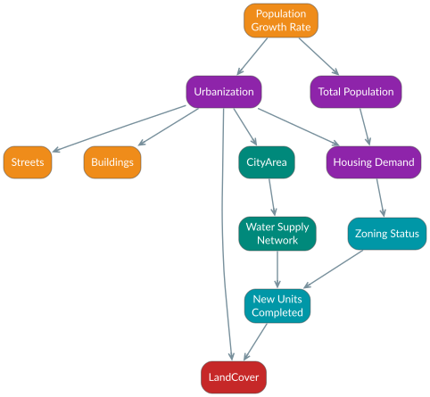
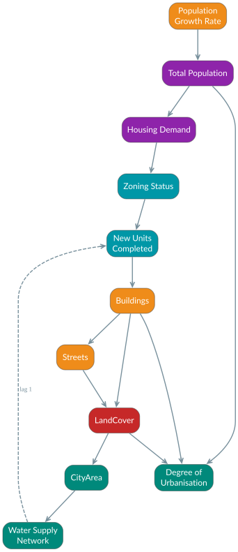

# Revisions of the causal graph (`core/DAG.dot`)

A dated log of every change to the DPSIR causal graph: what changed, why, and what it did to the coverage count (edges with real derivation logic, see `.claude/CLAUDE.md` › *DAG Edge Coverage Gaps*). The graph is the conceptual model behind CrossTwin, so a change to it is a modelling decision. This file keeps those decisions traceable for later critique, including the paper that reviews the original graph.

`core/test_dag.py` guards the conventions below. The graph must be acyclic once lagged edges are left out. Only the lagged edges listed in the test may close a loop. Every `A -> B` that code cites between two DAG nodes must be a DAG edge.

## Conventions

- **Node = measurable quantity.** A node needs a definition that can be stored or computed (a model field, a raster, a function). A node that cannot be measured cannot have an implemented edge.
- **Edge = cause at the same time step.** `A -> B` means that a change of A changes B now. The target's `save()` implements it and a receiver on A triggers it (*Implementing a DAG Edge* in `.claude/CLAUDE.md`).
- **Lagged edge** `[lag=1, style=dashed]`. The cause acts one planning step later (a feedback). It is left out of the acyclicity check and never implemented by a receiver, because a receiver would close the loop within one save. Each lagged edge is argued here and listed in `core/test_dag.py::LAGGED_EDGES`.
- **Counting.** Distinct `source -> target` pairs, legend excluded. `core/test_dag.py::parse_dag` is the reference parser.

## 2026-11-11: parks stored as green spaces (no graph change)

`builtup.Park` is removed; a park is now a `nature.GreenSpaces` row with `type = 'park'` (OSM `leisure=park` import, parks drawn in the map editor; BGT recreation areas keep their `plus_type`). Existing parks were copied by migration `nature/0004_move_builtup_parks`, which also re-pointed the editor parks' land-cover ownership (`source_park`, `owner_park`) to the new ids.

The graph needs no new node or edge. The two nodes this touches already describe green space generally, not parks: `Green_Area` (State) is now stored as `nature.GreenSpaces` + the green land-cover classes, and `New_Green_Area` ("Green Space Created", Response) is any green space drawn in the editor (before: only parks). A direct `New_Green_Area -> Green_Area` edge would duplicate the existing path `New_Green_Area -> LandCover -> Green_Area`, so it is not added. Park space (dashboards) = parks + BGT recreation areas (`type` `recreatie…`), added 2026-11-12. The status of `LandCover -> Green_Area`, `Green_Area -> Vegetation_Coverage`, `Green_Area -> Accessibility` and `New_Green_Area -> LandCover` is unchanged (`Green_Area -> Accessibility` stays a gap: there is still no `Accessibility` model).

**Coverage.** Unchanged: 105 distinct edges; 55 implemented, 4 partial, 46 gaps.

## 2026-11-10: the `Urbanization` node is replaced by the measured `Degree_Urbanisation`




(Sources: `docs/figures/dag_urbanization_before.dot`, `docs/figures/dag_urbanization_after.dot`; render with `dot -Tsvg`.)

### Before

`Urbanization` (a Pressure) had one parent, `Population_Growth`, and five children: `CityArea`, `Buildings`, `Streets`, `LandCover` and `Housing_Demand`. None of its six edges was implemented. No model, field or function defined the node.

### Critique of the original formulation

1. **Reification of an outcome.** Urbanisation is a process that is *read off* population and built form: people concentrate, homes are built, land is sealed. Drawing it as a parent of `Buildings`, `Streets` and `LandCover` makes the observed result its own cause. In a causal graph, the node that summarises a set of variables cannot also be their common cause without creating a loop or double counting.
2. **Double path for the same signal.** `Population_Growth -> Total_Population -> Housing_Demand` and `Population_Growth -> Urbanization -> Housing_Demand` both carry population growth to housing demand. Any implementation would count it twice or silently ignore one path.
3. **Missing mechanism.** The chain the node stood in for had no edges: nothing turned housing need into buildings (`New_Units` only fed `Housing_Supply` and `LandCover`), buildings into streets, or land cover into urban area. The abstraction hid exactly the steps a digital twin can simulate. A map edit adds a dwelling, a building or a street, not "urbanisation".
4. **Not operational.** Without a definition (unit, scale, data source), none of the six edges could be implemented: 0 of 6.
5. **Feedback hidden by the abstraction.** Urban growth reinforces itself. A larger urban area extends the water network, and network capacity enables new units. With an explicit chain the loop becomes visible, and a static DAG can only represent it through time indexing (see *lagged edge*).

### After

The causal chain follows the mechanism. More people need more homes, homes are buildings, buildings need streets, both change the land cover, and the urban area grows:

```
Population_Growth -> Total_Population -> Housing_Demand -> Zoning_Status -> New_Units
  -> Buildings -> Streets -> LandCover -> CityArea
                 Buildings ----------> LandCover
```

The degree of urbanisation is a **State** node measured from that chain, with no outgoing edges: `Total_Population, Buildings, LandCover -> Degree_Urbanisation`. It is computed with the GHSL/Eurostat Degree of Urbanisation rules on 100 m cells (`docs/DEGREE_OF_URBANISATION.md`). The urbanisation *rate* (`City.urbanizationRate`) is an attribute of this node over time (the growth of its urban area between stored years), not a node of its own.

| Change | Edge | Status |
|---|---|---|
| removed | `Population_Growth -> Urbanization`, `Urbanization -> CityArea`, `-> Buildings`, `-> Streets`, `-> LandCover`, `-> Housing_Demand` | were gaps |
| removed | `New_Units -> LandCover` (now the path through `Buildings`) | was implemented |
| added | `New_Units -> Buildings` | gap (completed projects are not turned into BAG buildings yet) |
| added | `Buildings -> Streets` | gap |
| added | `Streets -> LandCover` | gap |
| added | `Buildings -> LandCover` (the 10 m urban-fabric ring of an editor building, `physicalEnv/calculations/landcover.py::urbanize_around`) | implemented (code that used to be cited as `New_Units -> LandCover`) |
| added | `LandCover -> CityArea` (neighborhood `urban_area` from the urban land-cover classes, `physicalEnv/signals.py::_recompute_neighborhood_urban_area`) | implemented (existing code that had "no explicit DAG edge") |
| added | `Total_Population -> Degree_Urbanisation`, `Buildings -> Degree_Urbanisation`, `LandCover -> Degree_Urbanisation` | implemented (`builtup.Urbanisation`, `builtup/calculations/urbanisation.py`, `builtup/signals.py`) |
| changed | `Network -> New_Units` gets `[lag=1, style=dashed]` | gap, lagged |

**Loop.** With `LandCover -> CityArea`, the graph holds `CityArea -> Network -> New_Units -> Buildings -> (Streets ->) LandCover -> CityArea`. Network capacity enabling new units acts at the next planning step, so `Network -> New_Units` is the lagged edge that breaks the loop in the same-time graph.

**Coverage.**
- Before: 104 distinct edges; 51 implemented, 4 partial, 49 gaps (49 %).
- After: 105 distinct edges; 55 implemented, 4 partial, 46 gaps (52 %).

Correction found while writing the parser: two edge lines in `DAG.dot` have no semicolon (`Property -> Mortgage`, `WT_Efficiency -> Samples_WQ`). The older regex in `mainMap/tests.py` skips the line *after* each of them. The coverage count in `CLAUDE.md` was right (104); the new parser reads them correctly.

**Pre-existing citations that are not edges** (kept in `core/test_dag.py::KNOWN_UNDECLARED` until resolved): `Total_Population -> Household_Size` (housing: average household size = population / households), `Metered_Res_Water -> OPEX_Recovery`, `Total_Population -> Total_Water_Prod` (watershed share of extraction). Each is either a missing DAG edge or a loose docstring. Deciding which is a separate revision.

## 2026-11-05: `Canyon_Aspect -> DSM` removed

The canyon height/width ratio is read off the buildings, and the buildings already reach the DSM through `Buildings -> DSM`. Keeping both edges counted the same buildings twice. (`Buildings -> Canyon_Aspect`, `Streets -> Canyon_Aspect` and `Vegetation_Coverage -> DSM` were implemented the same week.)

## 2026-11-04: `LST -> PET` removed

PET is computed from the mean radiant temperature of SOLWEIG (`Tmrt -> PET`), the air temperature (with the Koopmans urban heat island) and the 1.2 m wind. The Landsat land surface temperature is a separate observed surface temperature and is not a PET input.
