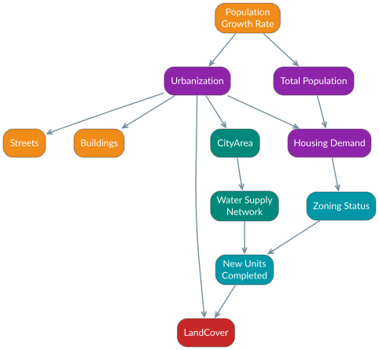
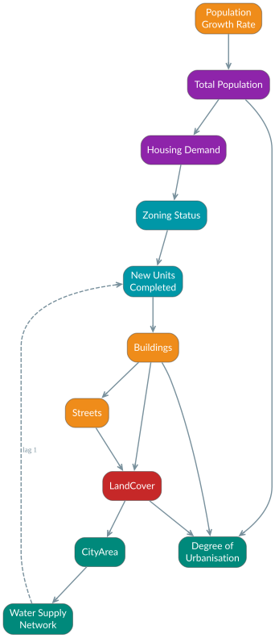

# Revisions of the causal graph (`core/DAG.dot`)

A dated log of every change to the DPSIR causal graph: what changed, why, and what it did to the coverage count (edges with real derivation logic, see `.claude/CLAUDE.md` › *DAG Edge Coverage Gaps*). The graph is the conceptual model behind CrossTwin, so a change to it is a modelling decision. This file keeps those decisions traceable for later critique, including the paper that reviews the original graph.

`core/test_dag.py` guards the conventions below. The graph must be acyclic once lagged edges are left out. Only the lagged edges listed in the test may close a loop. Every `A -> B` that code cites between two DAG nodes must be a DAG edge.

## Conventions

- **Node = measurable quantity.** A node needs a definition that can be stored or computed (a model field, a raster, a function). A node that cannot be measured cannot have an implemented edge.
- **Edge = cause at the same time step.** `A -> B` means that a change of A changes B now. The target's `save()` implements it and a receiver on A triggers it (*Implementing a DAG Edge* in `.claude/CLAUDE.md`).
- **Lagged edge** `[lag=1, style=dashed]`. The cause acts one planning step later (a feedback). It is left out of the acyclicity check and never implemented by a receiver, because a receiver would close the loop within one save. Each lagged edge is argued here and listed in `core/test_dag.py::LAGGED_EDGES`.
- **Counting.** Distinct `source -> target` pairs, legend excluded. `core/test_dag.py::parse_dag` is the reference parser.

## 2026-11-27: `Market_Reports -> House_Price_Index` removed

NVM market reports are no longer used (the reports' terms allow non-commercial private use only and the figures are not needed once the price level is the CBS WOZ value of the PC6 area). The node `Market_Reports` and its edge are removed from `core/DAG.dot`; `House_Price_Index` is a stored (imported or manual) value again, its derived fields, `NVMMarketReport`, `NVMRegionMapping`, the receivers `nvm_report_changed` and `nvm_mapping_changed` and `importer/nvm_reports.py` are deleted (migration `housing/0016`).

| change | edge | status |
|---|---|---|
| removed | `Market_Reports -> House_Price_Index` | was implemented |

**Consequences.** Acyclicity is unaffected (`Market_Reports` had no incoming edge). Coverage: 106 edges, 68 implemented (64 %), 7 partial, 31 gaps. `Accessibility -> Property` stays implemented; its equation is now a sum over amenity categories instead of two aggregate scores, and its what-if sliders (accessibility effect, accessibility change) are removed.

## 2026-11-26: `Market_Reports -> House_Price_Index` added

A driver node `Market_Reports` (housing: NVM quarterly market reports) is added. `House_Price_Index` had two incoming edges (`Housing_Demand`, `Property`), both gaps, and `HousePriceIndex.index_value` was a flat typed input: nothing in the graph said where observed prices come from. The market trend is measured (NVM's median transaction price per m² per region and quarter, stored in `housing.NVMMarketReport`), so the node meets the node convention. The CBS WOZ value per buurt (`housing.WOZValue`) is the price *level* for the Phase 4 hedonic model and is not a node: it is read only by that model (`docs/ACCESSIBILITY_PLAN.md`).

| change | edge | status |
|---|---|---|
| added | `Market_Reports -> House_Price_Index` | implemented (`HousePriceIndex.save()` -> `chain.price_index`; receivers `nvm_report_changed`, `nvm_mapping_changed`) |

**Consequences.** Acyclicity is unaffected: `Market_Reports` has no incoming edge. The index is region-wide (NVM reports per COROP area), so every neighborhood of a region gets the same index; neighborhood differences enter through the WOZ level in Phase 4. NVM's terms allow non-commercial private use only, so the PDFs are read from a folder the user fills, never downloaded by CrossTwin. Coverage: 107 edges, 68 implemented (64 %), 7 partial, 32 gaps.

## 2026-11-24: `Social_Profile -> Affordability_Stress` added

A node `Social_Profile` (State, housing) is added: the CBS socio-economic status score (`ses_woa`, standardised, Klimaateffectatlas) stored per neighborhood in `housing.NeighborhoodSocialProfile`. The graph had no way to say that the same housing-cost burden weighs more on a neighborhood with less welfare, education and work. The node is measurable (a stored field), so it meets the node convention.

`HousingAffordability.save()` derives `affordabilityStressLevel`, formerly a typed value with TODO thresholds: burden = 12 x (rent / mortgage weighted by the share of rental homes) / median annual income; the burden is multiplied by 1 + 0.10 per SD of below-average status (clamped at 2 SD) and cut at 30 % (moderate) and 40 % (high). The inputs used (burden, SES score, modifier, method string) are stored on the row.

| Change | Edge | Status |
|---|---|---|
| added | `Social_Profile -> Affordability_Stress` | implemented (`HousingAffordability.save()` -> `chain.ses_modifier`; receiver `social_profile_changed`) |
| re-rated | `Income_Expenses -> Affordability_Stress` | gap -> partial (the level is derived from the row's own income and rent/mortgage; those are still typed) |

**Consequences.** Acyclicity is unaffected: `Social_Profile` has no incoming edge. The 30/40 % bands follow Eurostat's housing-cost overburden threshold and the common 30 % rule, applied to gross income. The 10 %/SD weight is a calibration assumption, not a published coefficient. Coverage: 106 edges, 64 implemented (60 %), 7 partial, 35 gaps.

## 2026-11-16: `Climate_Change -> Meteorology` implemented as stored scenario runs (graph unchanged)

No edge is added or removed. The edge was partial (a what-if of the Scenarios panel). It is now also stored: `weather.ClimateScenarioRun` is the Climate_Change node, and the receivers of watersupply, housing and urban_heat store their scenario results (recharge per source, demand and supply security, homes needed, SOLWEIG Tmrt/UTCI/PET + WBGT). Coverage: 63 implemented, 6 partial, 36 gaps.

Two deliberate departures from "every input edge is a receiver":

- **Snapshot.** Scenario results do not subscribe to later changes of soil, land cover, KNMI or CBS data. A run is a dated experiment that records its inputs; the panel flags a run whose sources were recomputed or whose heat-model inputs changed (`urban_heat.HeatInputChange`), and *Recalculate* / *Rerun heat model* refresh it. Keeping it live would rerun SOLWEIG (minutes to hours) on every edit.
- **GPU from a receiver.** Creating a run (a staff POST, never imported, restored or bulk-written) queues its one SOLWEIG run (the shifted hour) from `urban_heat/signals.py`; a re-save never does.

WBGT is computed from Tmrt but is not a DAG node (it is an imported KNMI measure elsewhere); LST is not projected (surface reflectance), so `Meteorology -> LST` is not drawn.

## 2026-11-16: `Canyon_Aspect -> Meteorology` replaced by `DSM -> PET`

The edge stood for the urban form changing the local climate a pedestrian feels. CrossTwin computes that effect in SOLWEIG's PET (`urban_heat/solweig/pipeline.py::urban_pet`, pet-adjusted, Koopmans et al. 2020): the 10 m wind is reduced to 1.2 m with the frontal area densities of buildings and trees and their mean height (Macdonald), and the air temperature gets the urban heat island of each cell's upwind source area (sky view factor, vegetation). All of these are read off the DSM window with the editor's building and vegetation patches, never off the stored street H/W (`builtup.StreetCanyon`). A raster of frontal areas also describes the form better than one H/W per street (open squares, courtyards, trees). The edge as drawn could not be implemented without computing the same effect twice from two descriptions of the same buildings, so it is replaced by the mechanism the code implements.

It points to `PET`, not `Meteorology`: the adjusted wind and temperature are local to the PET calculation; `Meteorology` stays the uniform station/ERA5 input of Tmrt, UTCI and PET (`Meteorology -> PET`).

| Change | Edge | Status |
|---|---|---|
| removed | `Canyon_Aspect -> Meteorology` | was a gap |
| added | `DSM -> PET` | implemented, on demand (`urban_heat/solweig/pipeline.py::urban_pet`) |

**Consequences.** `Canyon_Aspect` becomes a sink: a State node measured from `Buildings` and `Streets` and shown on the heat dashboard's morphology card, consumed by no other node. Acyclicity is unaffected (`DSM` was already upstream of `PET` through `SVF`). Coverage: 105 edges, 62 implemented (59 %), 7 partial, 36 gaps.

## 2026-11-15: `Apparent_Losses -> ILI` replaced by `Network -> ILI`

The Infrastructure Leakage Index of the IWA Water Loss Task Force is ILI = CARL / UARL: current annual *real* losses over the unavoidable annual *real* losses (Lambert et al. 1999). Apparent losses (meter error, unauthorised use, data errors) are no leakage and enter neither term, so the edge described no mechanism and could never be implemented. It is removed. They still reach `NRW`.

What the graph lacked is the driver of the denominator. UARL = (18 Lm + 0.8 Nc + 25 Lp) x P depends on the network: mains length Lm, service connections Nc, private pipe length Lp and the operating pressure P. The ILI used to divide the losses by a percentage of themselves (`UnavoidableLossses_PCT`), so it ignored the network. `LeakageIndex` (one row per year) now sums UARL per city with the city's editable pressure (`CoverageWaterSupply.avg_pressure_m`, default 30 m, no pressure data is imported yet) and stores the inputs used.

| Change | Edge | Status |
|---|---|---|
| removed | `Apparent_Losses -> ILI` | was a gap |
| added | `Network -> ILI` | implemented (`LeakageIndex.save()` → `watersupply/calculations/chain.py::uarl_m3_d`) |
| re-implemented | `Real_Losses -> ILI` | implemented (CARL of `LeakageIndex`; formerly a sibling `update()` on the loss rows) |

**Consequences.** Acyclicity is unaffected: nothing downstream of `ILI` reaches `Network`. Nc counts dwellings within the service buffer as connections (each Dutch dwelling has its own meter), which overcounts shared connections of apartment blocks. `LeakageIndex.uarl_reliable` flags systems below the equation's range (Nc < 3000, < 20 connections/km or P < 25 m; Lambert & McKenzie 2002).

**Coverage.** 105 distinct edges. Before: 60 implemented, 7 partial, 38 gaps (57 %). After: 61 implemented, 7 partial, 37 gaps (58 %).

## 2026-11-12: `Buildings -> Streets` flipped to `Streets -> Buildings`

The edge said that new buildings cause their access streets. The neighbourhood generator (`builtup/calculations/generative.py`), the first code to implement either direction, works the other way round, as urban layout does in practice: the street grid is drawn first, the land it leaves is cut into blocks and plots, and the buildings are placed on them. Counting the edge as implemented while the code runs the opposite way would misstate the mechanism in a coverage figure that is cited, so the edge now follows the code.

| Change | Edge | Status |
|---|---|---|
| flipped | `Buildings -> Streets` → `Streets -> Buildings` | partial (footprints fill the blocks of the generated street layout; editing a street later does not re-place them) |
| implemented | `New_Units -> Buildings` | a completed `HousingProject` with a generated layout becomes streets, buildings and dwellings (`housing/signals.py`, `builtup/calculations/materialise.py`) |
| implemented | `Streets -> LandCover` | an editor street's surface becomes road land cover (`physicalEnv/calculations/landcover.py::street_area`) |

**Consequences.** `Streets` now has no parent in the graph: the generator creates a project's streets from the project itself, which would be `New_Units -> Streets`. That edge is not added in this revision. The acyclicity check is unaffected (nothing downstream of `Buildings` reaches `Streets`). The loop through the lagged edge is now `CityArea -> Network -> New_Units -> Buildings -> LandCover -> CityArea`.

**Coverage.** 105 distinct edges. Before: 55 implemented, 4 partial, 46 gaps (52 %). After: 57 implemented, 5 partial, 43 gaps (54 %).

## 2026-11-11: parks stored as green spaces (no graph change)

`builtup.Park` is removed; a park is now a `nature.GreenSpaces` row with `type = 'park'` (OSM `leisure=park` import, parks drawn in the map editor; BGT recreation areas keep their `plus_type`). Existing parks were copied by migration `nature/0004_move_builtup_parks`, which also re-pointed the editor parks' land-cover ownership (`source_park`, `owner_park`) to the new ids.

The graph needs no new node or edge. The two nodes this touches already describe green space generally, not parks: `Green_Area` (State) is now stored as `nature.GreenSpaces` + the green land-cover classes, and `New_Green_Area` ("Green Space Created", Response) is any green space drawn in the editor (before: only parks). A direct `New_Green_Area -> Green_Area` edge would duplicate the existing path `New_Green_Area -> LandCover -> Green_Area`, so it is not added. Park space (dashboards) = parks + BGT recreation areas (`type` `recreatie…`), added 2026-11-12. The status of `LandCover -> Green_Area`, `Green_Area -> Vegetation_Coverage`, `Green_Area -> Accessibility` and `New_Green_Area -> LandCover` is unchanged (`Green_Area -> Accessibility` stays a gap: there is still no `Accessibility` model).

**Coverage.** Unchanged: 105 distinct edges; 55 implemented, 4 partial, 46 gaps.

## 2026-11-10: the `Urbanization` node is replaced by the measured `Degree_Urbanisation`




(Sources: `docs/figures/dag_urbanization_before.dot`, `docs/figures/dag_urbanization_after.dot`; render with `dot -Tsvg`.)

### Before

`Urbanization` (a Pressure) had one parent, `Population_Growth`, and five children: `CityArea`, `Buildings`, `Streets`, `LandCover` and `Housing_Demand`. None of its six edges was implemented. No model, field or function defined the node.

### Critique of the original formulation

1. **Reification of an outcome.** Urbanisation is a process that is *read off* population and built form: people concentrate, homes are built, land is sealed. Drawing it as a parent of `Buildings`, `Streets` and `LandCover` makes the observed result its own cause. In a causal graph, the node that summarises a set of variables cannot also be their common cause without creating a loop or double counting.
2. **Double path for the same signal.** `Population_Growth -> Total_Population -> Housing_Demand` and `Population_Growth -> Urbanization -> Housing_Demand` both carry population growth to housing demand. Any implementation would count it twice or silently ignore one path.
3. **Missing mechanism.** The chain the node stood in for had no edges: nothing turned housing need into buildings (`New_Units` only fed `Housing_Supply` and `LandCover`), buildings into streets, or land cover into urban area. The abstraction hid exactly the steps a digital twin can simulate. A map edit adds a dwelling, a building or a street, not "urbanisation".
4. **Not operational.** Without a definition (unit, scale, data source), none of the six edges could be implemented: 0 of 6.
5. **Feedback hidden by the abstraction.** Urban growth reinforces itself. A larger urban area extends the water network, and network capacity enables new units. With an explicit chain the loop becomes visible, and a static DAG can only represent it through time indexing (see *lagged edge*).

### After

The causal chain follows the mechanism. More people need more homes, homes are buildings, buildings need streets, both change the land cover, and the urban area grows:

```
Population_Growth -> Total_Population -> Housing_Demand -> Zoning_Status -> New_Units
  -> Buildings -> Streets -> LandCover -> CityArea
                 Buildings ----------> LandCover
```

The degree of urbanisation is a **State** node measured from that chain, with no outgoing edges: `Total_Population, Buildings, LandCover -> Degree_Urbanisation`. It is computed with the GHSL/Eurostat Degree of Urbanisation rules on 100 m cells (`docs/DEGREE_OF_URBANISATION.md`). The urbanisation *rate* (`City.urbanizationRate`) is an attribute of this node over time (the growth of its urban area between stored years), not a node of its own.

| Change | Edge | Status |
|---|---|---|
| removed | `Population_Growth -> Urbanization`, `Urbanization -> CityArea`, `-> Buildings`, `-> Streets`, `-> LandCover`, `-> Housing_Demand` | were gaps |
| removed | `New_Units -> LandCover` (now the path through `Buildings`) | was implemented |
| added | `New_Units -> Buildings` | gap (completed projects are not turned into BAG buildings yet) |
| added | `Buildings -> Streets` | gap |
| added | `Streets -> LandCover` | gap |
| added | `Buildings -> LandCover` (the 10 m urban-fabric ring of an editor building, `physicalEnv/calculations/landcover.py::urbanize_around`) | implemented (code that used to be cited as `New_Units -> LandCover`) |
| added | `LandCover -> CityArea` (neighborhood `urban_area` from the urban land-cover classes, `physicalEnv/signals.py::_recompute_neighborhood_urban_area`) | implemented (existing code that had "no explicit DAG edge") |
| added | `Total_Population -> Degree_Urbanisation`, `Buildings -> Degree_Urbanisation`, `LandCover -> Degree_Urbanisation` | implemented (`builtup.Urbanisation`, `builtup/calculations/urbanisation.py`, `builtup/signals.py`) |
| changed | `Network -> New_Units` gets `[lag=1, style=dashed]` | gap, lagged |

**Loop.** With `LandCover -> CityArea`, the graph holds `CityArea -> Network -> New_Units -> Buildings -> (Streets ->) LandCover -> CityArea`. Network capacity enabling new units acts at the next planning step, so `Network -> New_Units` is the lagged edge that breaks the loop in the same-time graph.

**Coverage.**
- Before: 104 distinct edges; 51 implemented, 4 partial, 49 gaps (49 %).
- After: 105 distinct edges; 55 implemented, 4 partial, 46 gaps (52 %).

Correction found while writing the parser: two edge lines in `DAG.dot` have no semicolon (`Property -> Mortgage`, `WT_Efficiency -> Samples_WQ`). The older regex in `mainMap/tests.py` skips the line *after* each of them. The coverage count in `CLAUDE.md` was right (104); the new parser reads them correctly.

**Pre-existing citations that are not edges** (kept in `core/test_dag.py::KNOWN_UNDECLARED` until resolved): `Total_Population -> Household_Size` (housing: average household size = population / households), `Metered_Res_Water -> OPEX_Recovery`, `Total_Population -> Total_Water_Prod` (watershed share of extraction). Each is either a missing DAG edge or a loose docstring. Deciding which is a separate revision.

## 2026-11-05: `Canyon_Aspect -> DSM` removed

The canyon height/width ratio is read off the buildings, and the buildings already reach the DSM through `Buildings -> DSM`. Keeping both edges counted the same buildings twice. (`Buildings -> Canyon_Aspect`, `Streets -> Canyon_Aspect` and `Vegetation_Coverage -> DSM` were implemented the same week.)

## 2026-11-04: `LST -> PET` removed

PET is computed from the mean radiant temperature of SOLWEIG (`Tmrt -> PET`), the air temperature (with the Koopmans urban heat island) and the 1.2 m wind. The Landsat land surface temperature is a separate observed surface temperature and is not a PET input.

## 2026-11-27: `House_Price_Index -> Property` added, `Property -> House_Price_Index` lagged

The modelled price per m² of a dwelling is a price level at the WOZ year of the fit; the housing market moves it with the house price index of the year shown. So the index feeds the price (`House_Price_Index -> Property`, dashboard factor `chain.hpi_price_factor`: index(year) / index(WOZ year)). The old `Property -> House_Price_Index` would close a loop with it. The index is now the CBS national series (table 85773ENG), which the prices of one municipality do not move in the same step, so the property-to-index direction becomes the lagged feedback edge (`[lag=1, style=dashed]`): local prices reach the national index one step later. It was a gap before and stays unimplemented.

- Before: 106 distinct edges. After: 107 distinct edges (69 implemented, 8 partial, 28 gaps, 2 lagged).
