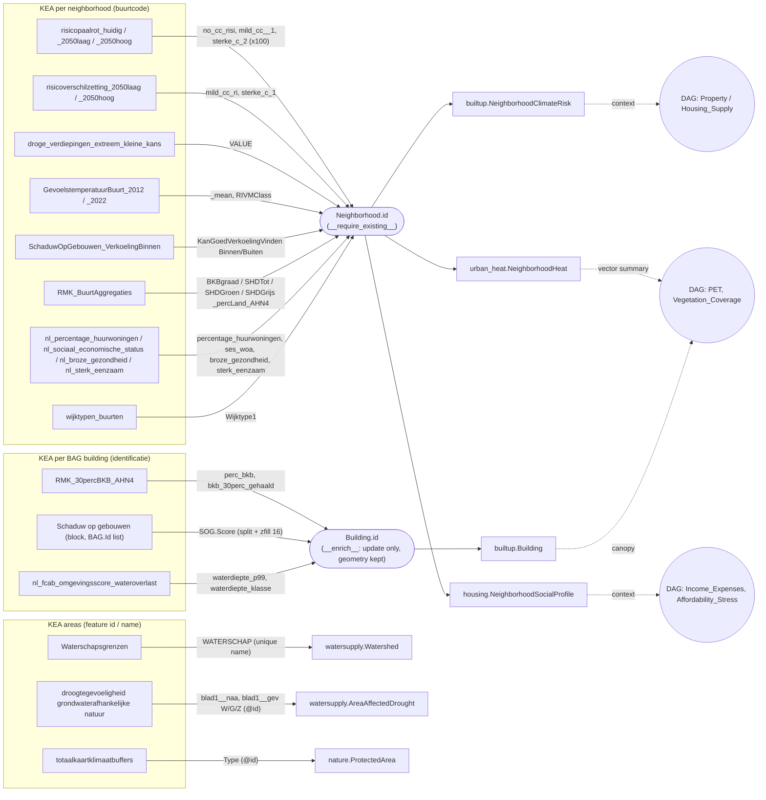

# Klimaateffectatlas (KEA) WFS → CrossTwin models

What the public WFS of the Klimaateffectatlas offers, which layers CrossTwin imports, into which model fields, and why the rest is not imported.

## The source

| | |
|---|---|
| Service | `https://cas.cloud.sogelink.com/public/data/org/gws/YWFMLMWERURF/kea_public/wfs` (GeoServer, WFS 2.0.0, no authentication) |
| Layers | 68 vector layers (the WMS of the same workspace has 185; the other ~117 are rasters, display only, no WCS) |
| CRS | Requested in EPSG:28992 (`srsName` of the catalog entry); GeoJSON output, `startIndex` paging |
| Join keys | Neighborhood layers: `buurtcode` / `bu_code` / `BU_CODE` / `Buurtcode` = `Neighborhood.id` (CBS code, e.g. `BU01530000`). Building layers: `identificatie` / `identificatie_bag` = `Building.id` (BAG pand id); the block layer lists its panden in `BAG.Id`, comma-separated and without the leading zero |
| Importer | `source: "kea"`, catalog keys `kea_*` in `importer/external_catalog.py`, run through `PDOKImporter.fetch_wfs` like the PDOK, RIVM and BIS layers |

The attributes below were read with `DescribeFeatureType` and checked against live features (Enschede, October 2026). Layer names with a date stamp (`_v20260722`, `_20251120`) are the publisher's versions, so update the catalog entry when KEA republishes.

## Mapping graph

Solid arrows are imports (edge labels name the KEA attributes). Dotted arrows name the `core/DAG.dot` nodes a value informs. All KEA values are stored inputs: no DAG edge is computed from them yet.

## Imported (21 layers)

### Per neighborhood → three new models (one row per neighborhood)

Every layer writes its own columns of the same row (upsert on `neighborhood_id`). Features whose buurt code is not stored are skipped and reported in the import message. 2012 buurt codes that no longer exist are dropped this way. Each row also stores the buurt polygon, so the model shows up as a map layer.

| Catalog key | KEA layer | KEA attribute | Model.field | Unit / transform |
|---|---|---|---|---|
| `kea_risicopaalrot_huidig` | `risicopaalrot_huidig` | `no_cc_risi` | `builtup.NeighborhoodClimateRisk.pileRotRisk_current_pct` | fraction × 100 → % of buildings |
| `kea_risicopaalrot_2050laag` | `risicopaalrot_2050laag` | `mild_cc__1` | `…pileRotRisk_2050low_pct` | fraction × 100 → % |
| `kea_risicopaalrot_2050hoog` | `risicopaalrot_2050hoog` | `sterke_c_2` | `…pileRotRisk_2050high_pct` | fraction × 100 → % |
| `kea_risicoverschilzetting_2050laag` | `risicoverschilzetting_2050laag` | `mild_cc_ri` | `…settlementRisk_2050low_pct` | % as delivered (0.9–17.7 in Enschede) |
| `kea_risicoverschilzetting_2050hoog` | `risicoverschilzetting_2050hoog` | `sterke_c_1` | `…settlementRisk_2050high_pct` | % as delivered |
| `kea_droge_verdiepingen` | `droge_verdiepingen_extreem_kleine_kans_20251120` | `VALUE` (key `BU_CODE`) | `…dryFloors_pct` | % of floors that stay dry |
| `kea_gevoelstemperatuur_buurt_2012` | `GevoelstemperatuurBuurt_2012` | `_mean` (key `bu_code`) | `urban_heat.NeighborhoodHeat.petMean_2012_C` | °C PET, hot day |
| `kea_gevoelstemperatuur_buurt_2022` | `GevoelstemperatuurBuurt_2022` | `_mean`, `RIVMClass` | `…petMean_2022_C`, `…heatClass_2022` | °C; RIVM class number |
| `kea_verkoeling` | `SchaduwOpGebouwen_VerkoelingBinnen` | `KanGoedVerkoelingVindenBinnen_59`, `…Buiten_60` (key `bu_code`) | `…coolingIndoor_pct`, `…coolingOutdoor_pct` | % of residents |
| `kea_boomkroon_buurt` | `RMK_BuurtAggregaties` | `BKBgraad_Tot_percLand_AHN4`, `SHDTot_…`, `SHDGroen_…`, `SHDGrijs_percLand_AHN4` (key `Buurtcode`) | `…canopyCover_pct`, `…shadeTotal_pct`, `…shadeGreen_pct`, `…shadeGrey_pct` | % of land area, AHN4 |
| `kea_huurwoningen` | `nl_percentage_huurwoningen_buurt_v20260722` | `percentage_huurwoningen` | `housing.NeighborhoodSocialProfile.rentalHousing_pct` | %; RIVM nodata codes → null |
| `kea_sociaal_economische_status` | `nl_sociaal_economische_status_buurt_v20260722` | `ses_woa` | `…socioEconomicStatus` | standardised score; nodata → null |
| `kea_broze_gezondheid` | `nl_broze_gezondheid_buurt_v20260722` | `broze_gezondheid` | `…frailHealth_pct` | % of adults; `-99997` → null |
| `kea_sterk_eenzaam` | `nl_sterk_eenzaam_buurt_v20260722` | `sterk_eenzaam` | `…severeLoneliness_pct` | % of adults; `-99997` → null |
| `kea_wijktypen` | `wijktypen_buurten` | `Wijktype1` (key `BU_CODE`) | `…neighborhoodType` | text (e.g. `Bloemkoolwijk`), 2023 buurt codes |

### Per BAG building → new fields on `builtup.Building` (enrichment)

These imports update existing buildings only. They never create a building and never overwrite `Building.geom`: the KEA polygon may be a whole building block. Writes use `update()`, and the map cache of `builtup.Building` and of its `Energy.BuildingEnergyLabel` proxy is bumped afterwards. Import *Buildings (BAG Panden)* first.

| Catalog key | KEA layer | KEA attribute | Building field | Unit / transform |
|---|---|---|---|---|
| `kea_boomkroon_panden` | `RMK_30percBKB_AHN4` | `perc_bkb`, `bkb_30perc_gehaald` (key `identificatie`) | `canopyCover_pct`, `meetsCanopy30Rule` | % canopy around the building; 3-30-300 rule met |
| `kea_schaduw_op_gebouwen` | `Schaduw op gebouwen` | `SOG.Score` (key `BAG.Id`, split on `,`, left-padded to 16 digits) | `facadeShadeScore` | 0–1, the block's score copied to each of its buildings |
| `kea_wateroverlast_panden` | `nl_fcab_omgevingsscore_wateroverlast_v20260806` | `waterdiepte_p99`, `waterdiepte_klasse` (key `identificatie_bag`) | `floodDepth_p99_m`, `floodDepthClass` | m, 70 mm/h cloudburst; class text (`10 tot 15 cm`) |

### Areas → existing models

| Catalog key | KEA layer | KEA attribute | Model.field | Notes |
|---|---|---|---|---|
| `kea_waterschappen` | `Waterschapsgrenzen` | `WATERSCHAP` | `watersupply.Watershed.name` | upsert on the name; water boards stand in for watersheds |
| `kea_droogtegevoelige_natuur` | `droogtegevoeligheidgrondwaterafhankelijkenatuur` | `blad1__naa`, `blad1__gev`, feature id | `watersupply.AreaAffectedDrought.areaName`, `.SensibilityLevel`, `.sourceID` (new field) | legend letters: W (weinig gevoelig) → 2 Low, G (gevoelig) → 3 Medium, Z (zeer gevoelig) → 4 High, none (not groundwater-dependent) → 0. `year` = year of import (the layer has none); `Province` and `areaAffected_km2` come from `save()` |
| `kea_klimaatbuffers` | `totaalkaartklimaatbuffers` | `Type`, feature id | `nature.ProtectedArea.name`, `.inspireID`; `protection_type = OTH` | `Legenda` is empty for most features |

## Not imported (47 layers)

Every layer below can still be shown on the map through the WMS of the same workspace (`register_wms_layer`, `format: "wms"`).

| KEA layer(s) | Count | Reason | Future target |
|---|---|---|---|
| `Provinciegrenzen` | 1 | Duplicates the PDOK *Bestuurlijke Grenzen* provinces already imported into `Province` (the same holds for `Gemeentegrenzen`, which `DescribeFeatureType` describes but GetCapabilities does not advertise, so it is not counted among the 68) | — |
| `werkregiogrenzen14012022`, `Gebiedsindeling_BRS` | 2 | Labour-market regions and flood-risk planning regions: no model for these divisions | an administrative "region" model |
| `RMK_BebouwdeKomGrenzen`, `RMK_LVR_AHN3/4/5` | 4 | Built-up-area parts of neighborhoods; CrossTwin has no sub-neighborhood unit (the neighborhood totals are imported from `RMK_BuurtAggregaties`) | — |
| `RMK_30percBKB_AHN3`, `RMK_30percBKB_AHN5` | 2 | Same attributes as the imported AHN4 layer; AHN3 is older and AHN5 does not cover the whole country yet | switch the catalog entry to AHN5 once complete |
| `BD_buurtdashboard_20260312` | 1 | ~300-column neighborhood dashboard that repeats the layers imported one by one (plus land-cover shares already derived from BRT) | — |
| `wijktypen_PC6` | 1 | Postcode-6 level; no PC6 geometry in CrossTwin | — |
| `Oppervlaktewaterverzilting_*_Rijn` | 12 | Surface-water salinisation classes (Rhine area only); no water-quality-by-area model | `nature.WaterBodies` salinity, or a water-quality model |
| `Verandering_doorspoelwatervraag_05m/1m/3m_ZSS` | 3 | Change in flushing-water demand per sea-level scenario; no model for regional water demand | watersupply demand scenarios |
| `Veranderingwaterstand…`, `Toenamehoogtedijkenenduinen…` (1 m, 3 m) | 4 | Dike trajectories (lines) with water-level / crest-height changes; no flood-defence model | a flood-defence model |
| `stijging_waterstanden_2050hoog` | 1 | River water-level rise per gauge station (Thiessen polygons); no model | — |
| `opwarming_oppervlaktewater_huidig/_2050hoog` | 2 | Surface-water warming risk classes; `WaterBodies` has no temperature/risk field | `nature.WaterBodies` field |
| `nl_bodemdaling_ondiep/_totaal_v20260623` | 2 | Subsidence speed polygons; no subsidence model | `physicalEnv.Subsidence` |
| `nl_bereikbaarheid_geen_dreiging/_grootschalige_extreme_neerslag` | 2 | Accessibility scores without and with extreme rain; no accessibility model (also missing for the DAG `Accessibility` node) | an `Accessibility` model |
| `nl_stroombanen_70mm_1h_v20260820` | 1 | Runoff flow-path points (flow vectors); no model | a stormwater model |
| `Afstand_tot_koelte` | 1 | Distance-to-cool-place classes (legend text only); better as WMS display | `urban_heat` cool-spot model |
| `bknsn_hoofdklasse`, `bknsn_subklasse`, `bkns_subklasse_2023_dreigingen_kansen` | 3 | Soil–climate landscape classes with coded threat/opportunity columns; semantics not documented in the service | — |
| `kans_grondwateroverlast_2050hoog` | 1 | Groundwater-nuisance probability classes (`gridcode`); no model, and the BIS groundwater depths already cover groundwater | `physicalEnv` groundwater scenarios |
| `tekort_opvwater_gem/extreem_huidig/_2050hoog` | 4 | Surface-water shortage per area for the 1967/1976 reference droughts; the drought model is per affected area with one level, not per reference year | `watersupply` drought scenarios |

Count: 21 imported + 47 not imported = 68.

## Importer directives added for KEA

They live in `importer/external_data.py` (`_prepare_features`, `_keep_existing`, `_enrich_rows`) and work for any GeoJSON source:

| Directive | Effect |
|---|---|
| `@id` | Synthesized property holding the GeoJSON feature id: an upsert key for layers without an id attribute |
| `__nodata__` | List of values stored as null (RIVM `-99995 … -99999`) |
| `__value_maps__` | `{property: {source value: stored value}}` (until now only in the CBS OData path) |
| `__value_scales__` | `{property: factor}` (fraction → %) |
| `__split__` | `{"property", "sep", "zfill"}`: one feature per listed value |
| `__require_existing__` | `{"property", "model"}`: skip features whose key is not a stored row of `model` |
| `__enrich__` | Update existing rows only, never create, never write the geometry |

## Running an import

1. `python manage.py migrate` (migrations `builtup 0006_kea`, `urban_heat 0005_kea`, `housing 0002_kea`, `watersupply 0003_areaaffecteddrought_sourceid`).
2. Import neighborhoods (and BAG buildings for the building layers) for the area.
3. *Retrieve Data from APIs* → source **Klimaateffectatlas** → pick a layer and the area.
