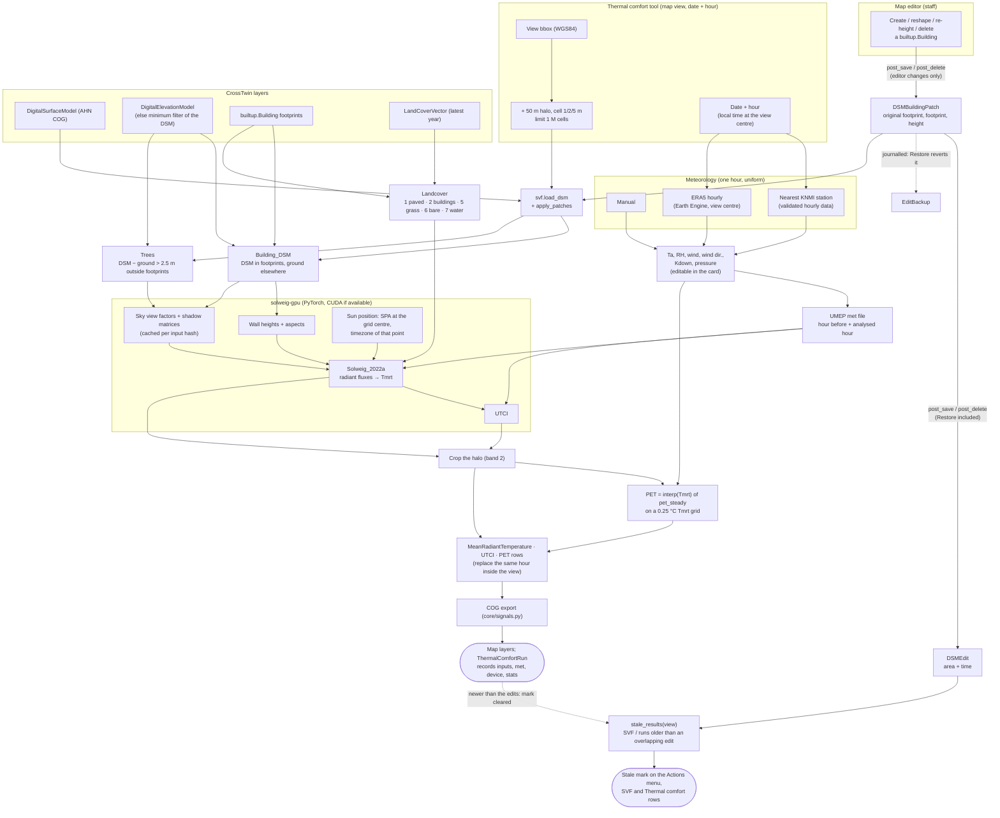

# Thermal comfort with SOLWEIG (Tmrt, UTCI, PET)

CrossTwin computes outdoor thermal comfort for the area shown on the map at
one hour chosen by the user. It combines the twin's stored layers (surface
model, terrain, buildings, land cover) with meteorology. The weather comes
from the user, from the KNMI station nearest to the area or from ERA5. The
radiation model is SOLWEIG (Lindberg et al. 2008), run on the GPU with
`solweig-gpu`. Building changes made in the map editor update the surface
model, and results they make outdated are flagged for recalculation.

Code: `urban_heat/solweig/` (`inputs.py`, `met.py`, `pipeline.py`,
`views.py`), `physicalEnv/dsm_patches.py`, `core/static/js/SolweigTool.js`.
Equations: `docs/functions_and_equations.tex` (sections *Building changes on
the DSM* and *Thermal comfort with SOLWEIG*).

## DPSIR edges

| DAG edge (`core/DAG.dot`) | Where |
|---|---|
| `Buildings -> DSM` | `physicalEnv/dsm_patches.py` (editor changes as an overlay on the DSM; receivers in `physicalEnv/signals.py`) |
| `DSM -> SVF` | SOLWEIG's sky view factors (cached per input); also the standalone SVF tool (`physicalEnv/svf.py`) |
| `SVF -> Tmrt`, `Meteorology -> Tmrt` | SOLWEIG 2022a radiant fluxes |
| `Tmrt -> UTCI`, `Meteorology -> UTCI` | SOLWEIG-GPU's UTCI |
| `Tmrt -> PET`, `SVF -> PET`, `Meteorology -> PET` | `pipeline.pet_lookup` (PET from Tmrt; SVF acts through Tmrt) |

The thermal-comfort run is computed on demand, not by a receiver: a model save
must never start a GPU job. `Buildings -> DSM` is stored and propagates through
signals. Its downstream results are not recomputed automatically; they are
marked stale instead.

## Process



## Steps

### 1. Area and time

The user opens **Actions → Calculate for this view → Thermal Comfort
(SOLWEIG)**, picks a date and an hour and a cell size (1, 2 or 5 m). The view's
bounding box is reprojected to EPSG:28992 and extended by `HALO_M` = 50 m on
every side. Shadows of buildings just outside the view still fall into it, and
the halo is cropped off the results. 50 m covers the shadow of a 30 m building
at a solar altitude of about 31°. The read window is limited to
`MAX_CELLS` = 1 M cells, about 1 × 1 km at 1 m.

The hour is local time at the view centre. Its timezone comes from
`timezonefinder`, the same lookup SOLWEIG uses for the sun, so a run in summer
uses CEST.

### 2. Surface model with the editor's building changes (`Buildings -> DSM`)

The DSM covering most of the view is read for the window (`svf.load_dsm`; the
AHN COG is warped onto the storage grid). Building changes made in the map
editor are applied on top (`dsm_patches.apply_patches`):

1. the original footprint of each edited building is set to ground level;
2. its current footprint is raised to ground + height: `height_m`, otherwise
   3 m per floor; with neither, the footprint is only cleared.

The DSM COG itself is never rewritten. It is a city-wide file, and an overlay
can be undone: patches are journalled with the editor's backup, so **Restore**
reverts them together with the buildings. Only editor changes create patches.
A BAG import must not replace AHN's measured roof shapes with flat blocks.

### 3. Ground

The ground is the DEM, read on exactly the same grid. Without a DEM it is
estimated from the DSM with a minimum filter over 40 m, which removes buildings
narrower than that. The source used is recorded in the run (`inputs.ground`).

### 4. SOLWEIG input rasters

| Raster | Derivation |
|---|---|
| `Building_DSM` | DSM inside `builtup.Building` footprints, ground elsewhere |
| `DEM` | ground |
| `Trees` | DSM − ground outside footprints where above 2.5 m (canopy height above ground), else 0 |
| `Landcover` | latest-year `LandCoverVector`, class names mapped to SOLWEIG classes (1 paved, 2 buildings, 5 grass, 6 bare soil, 7 water); buildings burned last; omitted without land cover |

AHN's DSM contains vegetation, which is why no separate tree layer is needed.
Note that SOLWEIG-GPU's documentation lists classes 3/4/5 for water,
vegetation and bare soil. The package's own table
(`landcoverclasses_2016a.txt`) uses 5/6/7, and it rewrites 3/4 to grass, so the
codes above follow the table.

### 5. Meteorology

One record for the hour, uniform over the view:

| Source | How |
|---|---|
| Manual | typed into the card |
| Nearest KNMI station | one request to KNMI's validated hourly data (`daggegevens.knmi.nl/klimatologie/uurgegevens`, all stations); the closest station to the view centre that measured temperature, humidity, wind and radiation that hour. The hour field `HH` is the UT hour the observation ends; global radiation Q (J/cm² per hour) → W/m² = Q·10⁴/3600 |
| ERA5 | `ECMWF/ERA5/HOURLY` on Earth Engine at the view centre: RH from dew point (Magnus), wind speed and from-direction from u/v, Kdown = ssrd/3600 s |

The fetched values fill the card and stay editable. The card shows the station
and its distance. A run stores the values it used and their source (`met` on
the `ThermalComfortRun`, the station name in the rasters' `source`).

The record is written as a UMEP met file with **two rows**, the hour before
and the analysed hour. SOLWEIG reads the file with `np.loadtxt`, which turns a
single row into a 1-D array it cannot index, and the extra hour lets SOLWEIG's
ground-temperature scheme settle. The result is band 2.

### 6. SOLWEIG-GPU

Called stage by stage with one tile:

1. wall heights and aspects (`walls_aspect.process_file_parallel`, the
   per-tile worker; `run_walls_aspect` would start a process pool);
2. `run_utci_tiles`: sky view factors and shadow matrices (cached in the
   work dir), solar position, Solweig_2022a radiant fluxes → Tmrt → UTCI.

`preprocess()` is not used: on bad input it calls `exit(1)`, which would end
the Django process. The tile layout it would produce is written directly
(`inputs.write_tiles`).

**Sun position.** SOLWEIG converts the centre of the input grid to WGS84 and
runs the SPA algorithm (Reda & Andreas 2004) there, with the UTC offset of that
point's timezone on the date. The sun therefore follows the area in view. The
card shows the solar altitude and azimuth before the run.

**Device.** PyTorch uses CUDA when available, otherwise the CPU (about 10×
slower). On an RTX 4050 laptop GPU (6 GB) the first run of a window takes about
1.2 ms per cell, most of it the sky view factors. A rerun of the same window
with other weather or another hour reuses them (~0.6 ms per cell). The work
dir is keyed by a hash of the input arrays (`cogs/solweig_work/<hash>/`), so a
building edit or a new DEM gives a new one.

**Execution.** A run takes minutes for a few hundred metres. It is therefore a
`ThermalComfortRun` executed in a background thread (one GPU run at a time),
and the card polls its status.

### 7. PET

With one met record, air temperature, humidity and wind are the same in every
cell, so PET depends on Tmrt alone. It is solved with `pythermalcomfort`'s
`pet_steady` (Höppe 1999, corrected by Walther & Goestchel 2018; standard
person 35 years, 1.75 m, 75 kg, 0.9 clo, 1.37 met) on a 0.25 °C grid over the
Tmrt range, then interpolated per cell. That is about a hundred solves instead
of one per cell. The test suite checks the lookup against direct solves
(< 0.05 °C). The 10 m wind of the met file is used as is, as UMEP's SOLWEIG
does.

### 8. Storage

One `MeanRadiantTemperature`, one `UTCI` and one `PET` row (°C, nodata −9999,
the view's extent):
- `date_time` is the analysed hour;
- `source` is `SOLWEIG DSM <id>: <met source>`;
- `measurement_method` records the model and device.

Their COGs are exported by `core/signals.py`, and the map adds the UTCI layer
(Tmrt and PET are listed for toggling). A rerun of the same hour replaces the
earlier rows inside the view; other hours are kept.

The `ThermalComfortRun` row records:
- the area;
- the met values;
- the inputs: DSM id, ground source, building cells, land cover, grid, halo,
  timezone, sun position;
- the device and statistics.

### 9. Stale results after building edits

Every change of a DSM patch appends a `DSMEdit` with the area it touched,
including Restore and deletes. An SVF raster or a finished run whose extent
overlaps an edit made after it is **stale** (`pipeline.stale_results`). The map
asks `/urban_heat/solweig/stale/?bbox=` after each building save, Restore and
map move. It shows an orange dot on the Actions button and on the Sky View
Factor / Thermal Comfort rows, and the card's button reads *Recalculate*.
Recalculating produces results newer than the edits, which clears the mark.

## Assumptions and limitations

- Meteorology is uniform over the view; the urban heat island effect on air
  temperature (`use_uhi`) and directional wind coefficients (`build_wind_ext_coeff`)
  are not used.
- Edited buildings get flat roofs on the median ground of their footprint.
- Trees are any non-building surface more than 2.5 m above the ground, which
  can include street furniture, bridges or vehicles in the DSM. Without a DEM,
  the ground estimate fails for buildings wider than 40 m.
- PET uses SOLWEIG's 10 m wind speed (no reduction to 1.1 m), like UMEP.
- Land-cover classes are mapped by name keywords; urban fabric counts as paved.
- One hour per run; a diurnal cycle would be 24 runs (the cached sky view
  factors make each additional hour cheaper).
- The validated KNMI hourly data and ERA5 lag real time by several days.

## Installation

```bash
uv sync --extra solweig          # solweig-gpu, torch (CUDA 12.8 wheels), pythermalcomfort
uv run python -c "import torch; print(torch.cuda.is_available())"
```

On Windows the GDAL bindings that solweig-gpu imports come from the Gohlke
wheel CrossTwin already installs. On Linux, solweig-gpu needs GDAL's Python
bindings (`osgeo`) matching the system libgdal.

## API

| Path | Purpose |
|---|---|
| `GET /urban_heat/solweig/info/?bbox=&datetime=&resolution=` | DSM, grid, cell count and limit, sun position, device, estimated time, stale results |
| `GET /urban_heat/solweig/met/?bbox=&datetime=&source=knmi\|era5` | Met values to prefill the card (and the station) |
| `POST /urban_heat/solweig/calculate/` | Start a run (staff): `bbox`, `datetime`, `resolution`, `ta_c`, `rh_pct`, `wind_ms`, `wind_dir_deg`, `kdown_wm2`, `pressure_kpa`, `source` |
| `GET /urban_heat/solweig/runs/<id>/` | Run status; when done, the three layers |
| `GET /urban_heat/solweig/stale/?bbox=` | SVF and thermal-comfort results made stale by building edits |

## References

- Lindberg, F., Holmer, B., & Thorsson, S. (2008). SOLWEIG 1.0 – Modelling spatial variations of 3D radiant fluxes and mean radiant temperature in complex urban settings. *International Journal of Biometeorology*, 52(7), 697–713.
- SOLWEIG-GPU 2.0.0. https://github.com/nvnsudharsan/solweig-gpu, https://solweig-gpu.readthedocs.io
- Bröde, P., Fiala, D., Błażejczyk, K., et al. (2012). Deriving the operational procedure for the Universal Thermal Climate Index (UTCI). *International Journal of Biometeorology*, 56(3), 481–494.
- Höppe, P. (1999). The physiological equivalent temperature – a universal index for the biometeorological assessment of the thermal environment. *International Journal of Biometeorology*, 43(2), 71–75.
- Walther, E., & Goestchel, Q. (2018). The P.E.T. comfort index: Questioning the model. *Building and Environment*, 137, 1–10.
- Reda, I., & Andreas, A. (2004). Solar position algorithm for solar radiation applications. *Solar Energy*, 76(5), 577–589.
- Hersbach, H., et al. (2020). The ERA5 global reanalysis. *Quarterly Journal of the Royal Meteorological Society*, 146(730), 1999–2049.
- Alduchov, O. A., & Eskridge, R. E. (1996). Improved Magnus form approximation of saturation vapor pressure. *Journal of Applied Meteorology*, 35(4), 601–609.
- KNMI. Uurgegevens van het weer in Nederland. https://www.daggegevens.knmi.nl/klimatologie/uurgegevens
